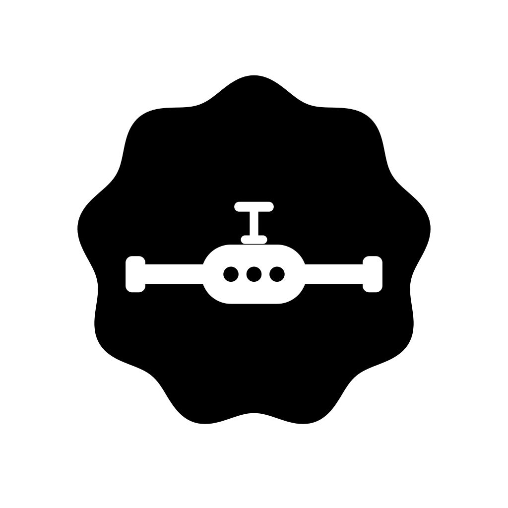

<p align="center">
  
</p>

<h1 align="center">Folio</h1>

<p align="center">
  <em>A notes app that feels like a typewriter.</em><br/>
  Kotlin · Jetpack Compose · Material 3 Expressive
</p>

<p align="center">
  
  
  
  
  
</p>

---

## ✍️ What is Folio?

Folio turns your phone into a typewriter. Your typing line never moves. A platen rod sits mid-screen, the carriage nip rides along it, and the paper feeds up line by line as you write. Every letter lands with slightly uneven ink, a soft *clack*, and a bell when you near the margin.

## ✨ Features

| | |
|---|---|
| 🖨️ **Fixed typing line** | The paper feeds up on an expressive spring. The carriage nip follows your caret along the rod. |
| 🖋️ **Real ink** | Each glyph is redrawn with uneven ink, a hair of jitter and tilt, and the odd faint double-strike. |
| 💡 **Desk lamp mode** | A dark room with a warm cone of light shining up from the nip. |
| 🔔 **Sound & haptics** | Key clacks, a margin bell and a carriage-return ratchet, plus a light tap on every key. All can be toggled. |
| ✖️ **No-delete drafting** | Backspace types an `x` over the letter instead of erasing it, just like the real thing. |
| 🎀 **Ribbons & paper** | Black, red or blue ink on lilac, onion skin, legal or kraft paper. |
| 📅 **Date stamp** | Stamp today's date onto the page. |
| 📦 **The Box** | Every page you've typed, in one grid. Long-press a page to shred it. |
| 🎛️ **Studio** | Set your default paper, sounds, haptics, lamp and drafting mode. |
| 📏 **3,000 characters a page** | Short, focused pages. Autosaved locally and shareable as text. |

## 🎨 Design

- **Material 3 Expressive**: `MaterialExpressiveTheme`, the expressive `MotionScheme`, `MaterialShapes.Cookie9Sided`, and big soft corners.
- **Type**: [Special Elite](https://fonts.google.com/specimen/Special+Elite) on the page, [Courier Prime](https://fonts.google.com/specimen/Courier+Prime) for the UI.
- **Logo**: a black-and-white typewriter nip on an M3E cookie shape.

### One nip, everywhere

The logo and the in-app carriage are drawn from the **same path data**, so they can never drift apart.

```
design/gen_nip.py        ← single source of truth: rod, carriage pill, I-beam
        │
        ▼
design/emit_android.py   → nip/NipGeometry.kt          (in-app roller & carriage)
                         → drawable/ic_launcher_*.xml  (adaptive + themed icon)
                         → mipmap-*/ic_launcher.png    (legacy icons)
                         → raw/*.wav                   (synthesized typewriter sounds)
```

To change the nip:

```bash
pip install cairosvg
python3 design/gen_nip.py && python3 design/emit_android.py
```

## 🚀 Getting started

**Requirements:** Android Studio (latest stable), JDK 17, and a device or emulator on Android 8.0 (API 26) or newer.

```bash
git clone https://github.com/<your-username>/folio.git
cd folio
./gradlew installDebug
```

Or open the folder in Android Studio and hit **Run**.

## 🗂️ Project structure

```
app/src/main/java/com/folio/typewriter/
├── MainActivity.kt
├── FolioViewModel.kt
├── data/            # Note model, JSON storage, settings
├── nip/             # NipGeometry (generated), RollerBar, FolioLogo
└── ui/
    ├── editor/      # Typewriter editor, ink renderer, paper texture, sounds
    ├── home/        # The Box
    ├── studio/      # Settings
    ├── icons/       # Lightweight vector icons
    └── theme/       # M3 Expressive theme, colors, typography
design/              # Logo + nip generators and exported artwork
```

## 🧰 Tech stack

- Kotlin 2.4 · Jetpack Compose (BOM 2026.11.01) · Material 3 1.5.0
- AndroidX Lifecycle / ViewModel · SplashScreen · Graphics Shapes
- `SoundPool` for audio, local JSON for storage (no network, no tracking)

## 🛣️ Roadmap

- [ ] Export a page as a "typed sheet" image or PDF
- [ ] Swipe the carriage to return
- [ ] Ink that ages on older pages
- [ ] Animation for pulling a finished page out of the machine
- [ ] Room database + search
- [ ] Stamps and doodles

## 🤝 Contributing

Issues and pull requests are welcome. For big changes, please open an issue first so we can talk it through.

## 📄 License

Code: MIT. See `LICENSE`.
Fonts: Special Elite (Apache 2.0) and Courier Prime (SIL OFL 1.1), under their own licenses.
